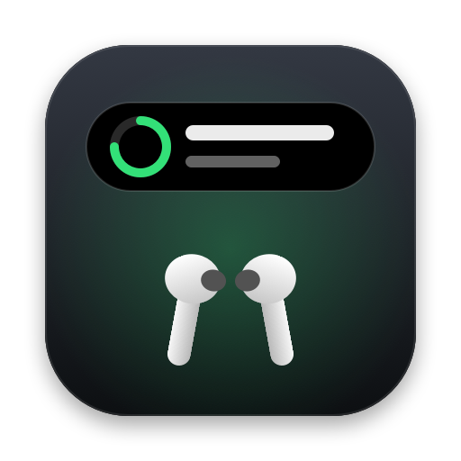
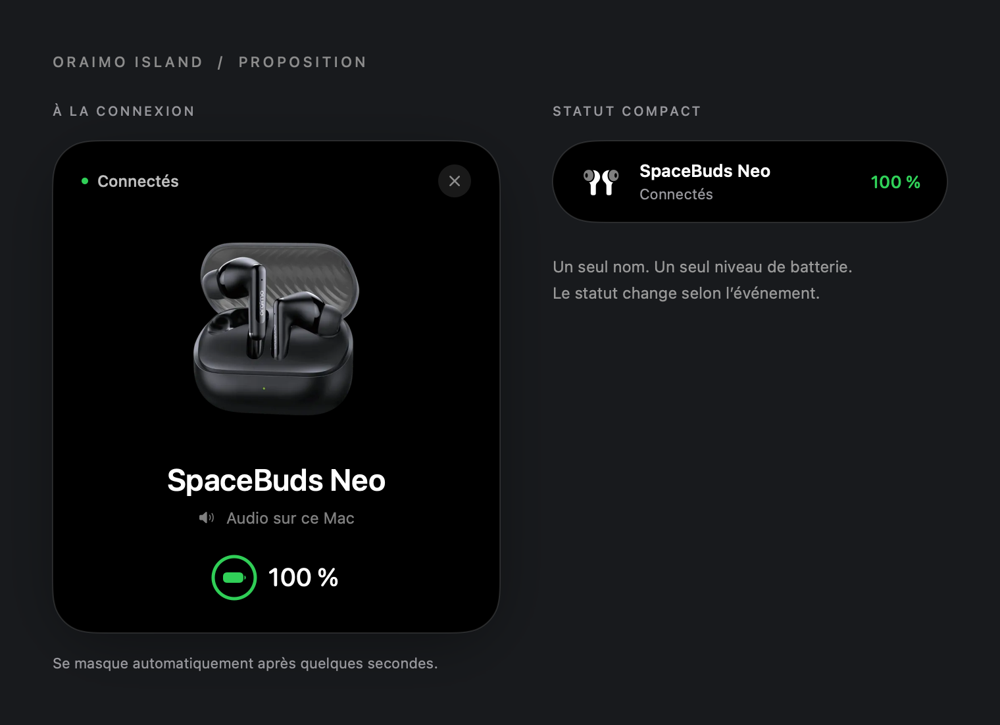

<div align="center">



# Oraimo Island pour Mac

**Une popup à la connexion de tes Oraimo. Une icône discrète le reste du temps.**


[](LICENSE)

### [Télécharger le DMG pour Mac](https://github.com/mooosmad/oraimo-island-mac/releases/latest/download/Oraimo-Island-macOS-universal.dmg)

[Toutes les versions](https://github.com/mooosmad/oraimo-island-mac/releases) · [Signaler un problème](https://github.com/mooosmad/oraimo-island-mac/issues)

</div>

## Ce que fait l’app

Oraimo Island reconnaît les appareils Oraimo appairés à ton Mac et affiche une popup près du haut de l’écran. Elle montre la photo du modèle et le niveau de batterie réellement disponible.

- **À la connexion** : popup pendant environ **6 secondes**, puis seule l’icône reste dans la barre des menus.
- **À la déconnexion** : message pendant environ **4 secondes**, puis l’icône disparaît si aucun Oraimo n’est connecté. La surveillance continue en arrière-plan.
- **Présentation adaptée** : écouteurs pour SpaceBuds Lite 2 et SpaceBuds Neo ; casque pour BoomPop Pro ; pictogramme de montre pour Watch 6 Nano.
- **Batteries indépendantes** : une mesure d’un appareil n’est jamais réutilisée pour l’autre. Les valeurs inconnues restent masquées.
- **Menu discret** : afficher la popup, choisir l’appareil, personnaliser sa photo, consulter le diagnostic ou quitter.

Il s’agit d’une app de barre des menus : **aucune fenêtre principale ni icône permanente dans le Dock**. L’encoche n’est pas nécessaire. Le nom « Island » décrit l’interface de cette app, pas une fonction système Apple.

<p align="center">
  
</p>

*Aperçu de la nouvelle interface, avec un niveau de batterie d’exemple. Les valeurs réellement absentes restent masquées.*

## Mises à jour

À partir de la prochaine version intégrant cette fonction, l’app vérifie la dernière release stable publiée sur GitHub au lancement, puis au maximum une fois par jour tant qu’elle tourne. Une nouvelle version est proposée une seule fois avec **Télécharger**, **Plus tard** ou **Ignorer cette version**.

Dans le menu Oraimo Island : **Rechercher des mises à jour…** force une vérification, même pour une version ignorée ; **Vérifier automatiquement les mises à jour** active ou désactive la vérification en arrière-plan. Le menu est accessible lorsqu’un Oraimo est connecté.

Le téléchargement s’ouvre dans ton navigateur. Quitte l’app, ouvre le nouveau DMG et remplace l’app dans **Applications**, puis relance-la. L’app ne remplace jamais ses fichiers automatiquement.

**Si tu utilises la v0.2.0 ou une version antérieure**, installe une première fois la nouvelle version depuis le lien du README pour bénéficier des alertes suivantes.

La vérification contacte l’API publique de GitHub ; aucun nom d’appareil, adresse Bluetooth ou niveau de batterie n’est envoyé. Sans réseau, les vérifications automatiques restent silencieuses ; la vérification manuelle signale l’échec.

## Compatibilité

| Élément | Prérequis / état |
|---|---|
| Système | **macOS 14 Sonoma ou plus récent** |
| Processeur | **Apple Silicon et Intel**, même DMG universel |
| Modèles testés | **oraimo SpaceBuds Lite 2** et **oraimo BoomPop Pro** |
| SpaceBuds Neo | Reconnaissance du nom « oraimo SpaceBuds Neo » ; batterie globale lue dans le rapport système |
| Watch 6 Nano (OSW-807N) | Reconnaissance du nom « oraimo Watch 6 Nano », y compris son suffixe ; batterie non confirmée |
| Autres Oraimo | Détection par nom contenant « oraimo » ; présentation générique pour les modèles non reconnus |
| Machine sans encoche | Compatible : popup centrée en haut de l’écran |
| Windows / Linux / iPhone | Non inclus dans ce dépôt ni dans ce DMG |

Les deux architectures sont compilées dans le binaire. Le comportement matériel a été observé sur un Mac Apple Silicon ; les Mac Intel et les anciennes versions compatibles de macOS n’ont pas encore été validés sur de vraies machines.

## Installer en 2 minutes

1. Clique sur **[Télécharger le DMG](https://github.com/mooosmad/oraimo-island-mac/releases/latest/download/Oraimo-Island-macOS-universal.dmg)**. Il n’est pas nécessaire de télécharger le code ni d’installer Xcode.
2. Ouvre `Oraimo-Island-macOS-universal.dmg`.
3. Glisse **Oraimo Island.app** dans **Applications**.
4. Éjecte le disque « Oraimo Island » dans le Finder.
5. Ouvre **Oraimo Island** depuis Applications.
6. Si macOS demande l’accès au **Bluetooth**, autorise-le pour permettre la détection et les lectures disponibles.
7. Appaire/connecte tes Oraimo dans **Réglages Système → Bluetooth**. La popup apparaît à la connexion.

### Si macOS bloque l’ouverture

Cette première distribution est **signée localement (ad hoc), sans certificat Developer ID et sans notarisation Apple**. Un avertissement de macOS est donc possible après le téléchargement.

Si tu as bien téléchargé ce dépôt et souhaites ouvrir cette version de test :

1. Tente d’ouvrir Oraimo Island une première fois.
2. Va dans **Réglages Système → Confidentialité et sécurité**.
3. Si Oraimo Island apparaît dans le message de blocage, clique sur **Ouvrir quand même** et confirme l’app concernée.

Cette exception concerne cette app. Nul besoin de désactiver Gatekeeper ou SIP, ni de lancer une commande qui supprime les protections de macOS. Si l’option n’est pas proposée ou si une détection de logiciel malveillant est annoncée, arrête l’installation et ouvre une issue avec le message exact.

Voir la [procédure officielle Apple](https://support.apple.com/fr-fr/102445). Une distribution Developer ID notarisée n’est pas encore disponible.

## Utilisation quotidienne

Tu peux laisser l’app ouverte en arrière-plan. Quand un Oraimo est connecté, clique sur son icône dans la barre des menus pour accéder au menu. Le pictogramme suit le modèle affiché : casque, écouteurs ou montre.

Si aucun appareil n’est connecté, l’icône est volontairement cachée. Pour retrouver la popup, **rouvre Oraimo Island depuis Applications** ; cela ne crée pas une seconde instance.

Le bouton **Fermer** masque la popup. Le menu **Quitter Oraimo Island** arrête la surveillance. Pour ouvrir automatiquement l’app à la connexion de ta session Mac, ajoute-la toi-même dans **Réglages Système → Général → Ouverture et extensions → Ouvrir avec la session** (le nom de la rubrique peut varier selon macOS).

## Watch 6 Nano (OSW-807N)

La montre doit être appairée et connectée au Mac. Son nom Bluetooth doit conserver « oraimo Watch 6 Nano » ; le suffixe propre à l’appareil est accepté. Le menu **Appareils Oraimo** permet de sélectionner la montre ou un autre appareil par son identité Bluetooth, même si deux appareils portent le même nom. **Sélection automatique** rétablit le choix selon la sortie audio ou les appareils disponibles.

La popup utilise un pictogramme système de montre, et les messages « Montre connectée » / « Montre déconnectée ». Tu peux importer une photo dédiée à ce modèle. Les modèles Oraimo inconnus ne réutilisent plus la photo des SpaceBuds.

Lors du diagnostic matériel initial, macOS reconnaissait la Watch 6 Nano comme une montre connectée, mais ne fournissait aucun niveau de batterie dans son rapport Bluetooth. La batterie reste masquée en l’absence de mesure réelle. Les sources de lecture existantes sont conservées ; aucun protocole propriétaire n’est ajouté. Le support ne comprend ni les données de santé, ni les notifications du téléphone, ni la synchronisation avec Oraimo Health.

## Batterie : ce qui est réellement disponible

Le niveau dépend de ce que le casque et macOS exposent. L’app consulte le rapport Bluetooth de macOS, certains getters IOBluetooth privés vérifiés à l’exécution et, si présent sur un périphérique déjà connecté, le service BLE standard de batterie.

- Un **niveau global** peut être affiché sans que gauche, droite ou boîtier soient disponibles.
- Un champ absent n’affiche ni « Non disponible », ni un faux 0 %.
- Une batterie basse explicitement reçue déclenche l’indication correspondante ; l’app ne devine pas son état.
- Les getters privés peuvent changer dans une mise à jour de macOS. Une source de secours lit le rapport système.
- **ANC, Concentration, état du couvercle et niveaux séparés non exposés ne sont pas pris en charge.**

L’app ne désappaire pas tes Oraimo, ne change pas leur sortie audio et n’envoie aucune commande propriétaire. L’exploration BLE facultative est limitée à 12 secondes ; elle observe les annonces et tente une lecture standard sur les périphériques déjà connectés.

## Dépannage

| Problème | À vérifier |
|---|---|
| Pas d’icône | Connecte un Oraimo. L’icône est cachée quand tous sont déconnectés. Rouvre l’app depuis Applications pour accéder à la popup. |
| Pas de popup | Vérifie que l’app tourne, que l’appareil est connecté au Mac et que son nom contient « oraimo ». La détection est interrogée environ toutes les 2 secondes. |
| Batterie absente | Vérifie le niveau dans les réglages Bluetooth du Mac. Si aucune source accessible ne le fournit, l’app masque le champ. |
| Bluetooth refusé | Autorise Oraimo Island dans Réglages Système → Confidentialité et sécurité → Bluetooth, puis relance l’app. |
| Photo incorrecte | Choisis le bon modèle dans le menu. Tu peux importer une photo différente pour chaque modèle. |
| Plusieurs icônes | Quitte les anciennes copies de développement, puis ouvre uniquement l’app copiée dans Applications. |
| L’app ne démarre pas | Vérifie macOS 14 minimum, télécharge de nouveau le DMG et consulte le blocage d’ouverture décrit plus haut. |

Pour une issue utile, indique ton modèle de Mac, la version de macOS, le modèle Oraimo et le comportement observé. Masque les adresses Bluetooth et les informations personnelles de tes captures.

## Vérifier un téléchargement

Chaque release contient `SHA256SUMS.txt`. Télécharge-le dans le même dossier que le DMG, puis, depuis ce dossier :

```sh
shasum -a 256 -c SHA256SUMS.txt
```

Le résultat attendu est `Oraimo-Island-macOS-universal.dmg: OK`. Cette empreinte vérifie l’intégrité du téléchargement ; elle ne remplace pas une notarisation Apple.

## Compiler depuis les sources

Pour les développeurs uniquement : macOS 14+, outils Swift / Command Line Tools ou Xcode. Le compilateur utilisé doit savoir compiler les deux cibles macOS.

```sh
git clone https://github.com/mooosmad/oraimo-island-mac.git
cd oraimo-island-mac
./Tests/run.sh
./build.sh
./scripts/package-dmg.sh
```

L’icône `Resources/OraimoIsland.icns` est dessinée par `scripts/make-icon.swift` : `swift scripts/make-icon.swift /tmp/OraimoIsland.iconset && iconutil -c icns /tmp/OraimoIsland.iconset -o Resources/OraimoIsland.icns`.

Résultats dans `dist/` : app universelle, DMG et fichier de sommes SHA-256. Le cache est dans `.build/` ; `ORAIMO_MODULE_CACHE` permet d’en choisir un autre.

Par défaut, le build est signé ad hoc. Un mainteneur disposant d’un **Developer ID Application** peut fournir `SIGNING_IDENTITY` à `build.sh`, puis effectuer la notarisation Apple séparément. Le script ne prétend pas notariser l’app.

## Confidentialité et ressources

Pas de serveur, de compte, de télémétrie ou de micro. Les lectures Bluetooth restent locales. Seules la photo personnalisée et les données nécessaires à l’app sont stockées localement dans `~/Library/Application Support/OraimoIsland/`.

Les noms et images de produits identifient les appareils compatibles ; ils appartiennent à leurs titulaires respectifs. Projet indépendant, **sans affiliation avec Oraimo ou Apple**.

Pour désinstaller : quitte l’app et supprime Oraimo Island de ton dossier Applications. Tu peux également supprimer son dossier Application Support si tu veux effacer tes photos personnalisées.


## Licence et contributions

Le **code et la documentation sont open source sous licence [MIT](LICENSE)**. Tu peux les utiliser, modifier et redistribuer, en conservant la notice de copyright et le texte de la licence. Le logiciel est fourni sans garantie.

Les images de produits et les marques tierces ne sont pas couvertes par la licence MIT du code ; voir [THIRD_PARTY_NOTICES.md](THIRD_PARTY_NOTICES.md).

Pour contribuer : fais un fork, crée une branche, lance `./Tests/run.sh`, puis ouvre une pull request vers `main`. Décris le changement et les vérifications effectuées. Toute contribution de code ou de documentation doit pouvoir être publiée sous la licence MIT du projet ; identifie séparément les éventuelles ressources tierces.
